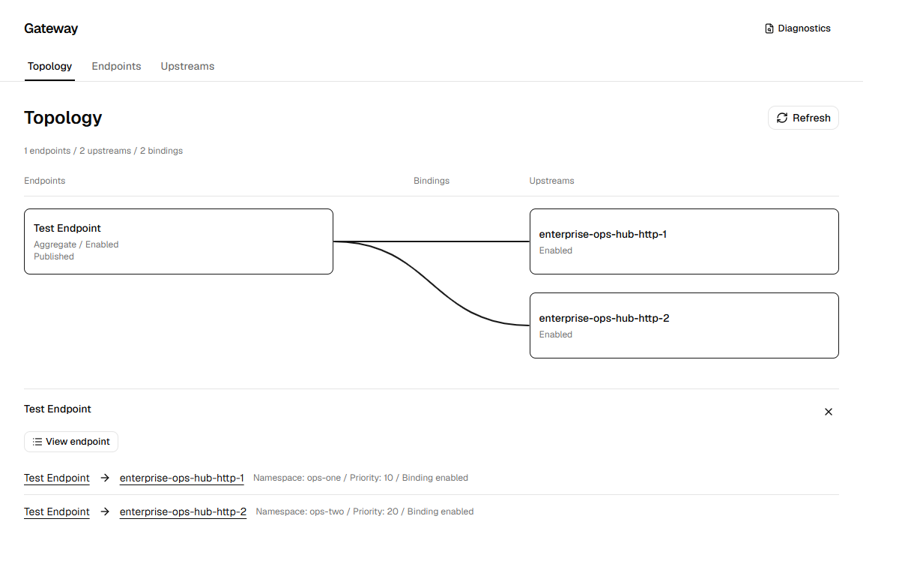
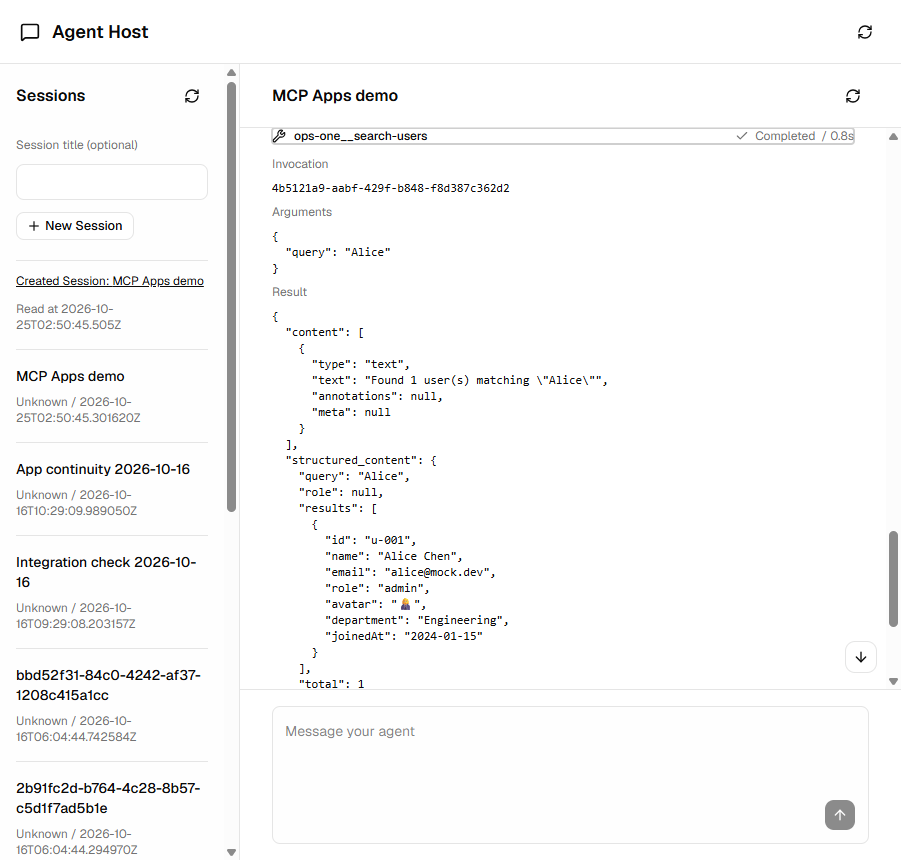
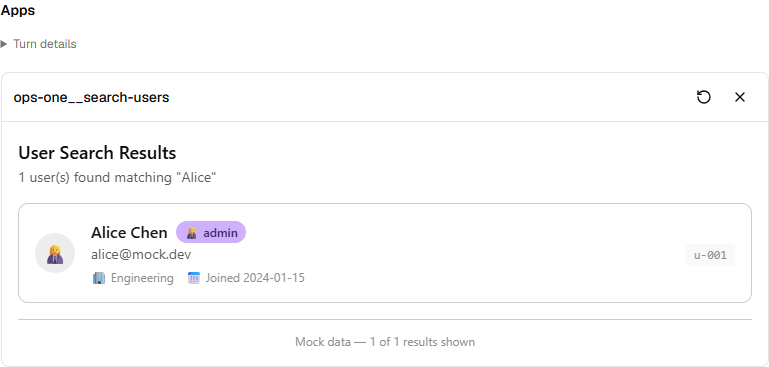

# Mabrid

[English](README.md) | [简体中文](README.zh.md)

[](https://github.com/JilongSun/mabrid/releases/tag/v0.1.0)
[](./backend/pyproject.toml)
[](./Dockerfile)
[](./LICENSE)

Mabrid is a self-hosted MCP gateway for enterprises, individual developers, and
agent users. It also provides an optional, session-centered Agent Host designed
to work across agent runtimes.

The MCP gateway gives you one place to manage external MCP servers. The Agent
Host gives developers a ready-made chat interface to test their own AI agents
and LLM applications, without building a frontend just for testing.

Together, the gateway and Agent Host provide a foundation for additional
features, such as interactive MCP Apps.

> [!NOTE]
> v0.1 is a developer preview. Features are still being developed and refined.
> Mabrid's APIs are not yet stable and may change between releases.

## Why Mabrid

### MCP Gateway

Bring external MCP servers together behind shared endpoints, with namespaces
that keep tools from different servers distinct. Inspect server configuration,
connections, and bridge sessions in one place. The gateway keeps tool and resource
metadata in memory for session routing; tool results and resource contents are
not cached.



### Session-centered Agent Host

Connect different agent runtimes through adapters and use sessions to organize
testing. View conversation history, streaming responses, tool inputs and results,
and execution status together, so you can follow what happened during a test.
The integration is non-invasive: your runtime keeps control of agent execution,
conversation history, and context.



### Built to extend

The gateway and Agent Host provide a foundation for additional features.
Event broadcasting and the observer pattern let extensions consume activity
without putting feature-specific logic into the protocol bridge or agent runtime.
MCP Apps support is one example: it builds on tool activity to show interactive
interfaces alongside results.



The current agent integration connects to a separately deployed Hermes runtime
over HTTP/SSE. Mabrid does not run Hermes inside its container.

## Quick Start

### Requirements

- **Local development:** Git, Python 3.12+, [uv](https://docs.astral.sh/uv/),
  Node.js 22.12+, and pnpm 11.9.0.
- **Docker deployment:** Git and Docker with Compose 2.30+ and Linux container support.

Commands below use Make by default, with [just](https://just.systems) alternatives
for cross-platform use.

### Get the code and configure

```sh
git clone https://github.com/JilongSun/mabrid.git
cd mabrid
make setup # or: just setup
```

Edit the generated `mabrid.yaml` to point to your MCP servers. The sample
addresses need to be replaced. To enable Agent Host, also configure its runtime
connection.

Use the `.env` file beside `mabrid.yaml` for API keys. For example:

```dotenv
API_SERVER_KEY=your-api-key
```

In `mabrid.yaml`, `apiKeyEnv` names the environment variable to read, not the key
itself. Keep `.env` out of version control.

### Run locally

```sh
make install # or: just install
make dev     # or: just dev
```

Open <http://localhost:5173> in your browser. The backend listens on port 8765.

To run only the backend or frontend, enter its directory and run
`make install` (or `just install`), then `make dev` (or `just dev`).

### Deploy with Docker

```sh
make build # or: just build
make run   # or: just run
```

Open <http://127.0.0.1:8765> in your browser.
Stop the container with `make stop` (or `just stop`). Data is kept in a Docker volume.

See the [container guide](docs/deployment/container.md) for more deployment options.

## Before you use it

Mabrid is preparing for its **v0.1 developer preview**. It is intended for
trusted, self-hosted use, not a public multi-user service.

- Keep it on a trusted network. Management APIs have no authentication, and
  session diagnostics may contain tool inputs and results.
- Gateway configuration is read-only in the web interface. The MCP server and
  endpoint configuration is imported into an empty database on first startup.
  Later YAML edits do not update that stored configuration.
- MCP Apps can display and exchange tool data. App-triggered follow-up messages
  and tool calls are not supported in v0.1.
- Desktop packaging and multi-worker deployments are outside v0.1.

## License

[Apache License 2.0](LICENSE).
